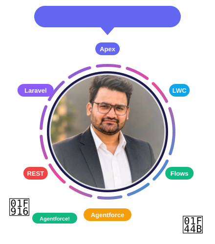
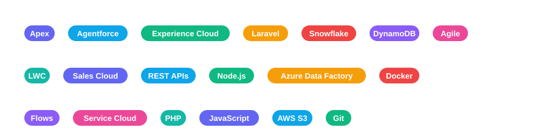

---

## 👋 About Me

Software Engineer with **5+ years** of experience: **~3 years in Salesforce** (Apex, LWC, Flows, Agentforce, Sales/Service/Experience Cloud) and **~2 years in PHP/Laravel & backend**. I build AI-driven support workflows, Salesforce-native solutions, CRM automation and third-party integrations.

## 🛠️ Tech Stack (floating live!)

## 🚀 Experience (click to expand)

<b>⚡ Software Engineer — Cloud Science Labs</b> <i>(Nov 2024 – Present)</i>

- 🤖 Implemented an **Agentforce Service Agent** for AI-driven customer support
- 🔄 Designed automated support workflows to cut manual effort
- 🏠 Re-architected a real estate solution, replacing **Propertybase** with native Salesforce to reduce third-party costs
- 🔌 Built property listing management and integrated external listing platforms using Apex & Flows

<b>🎬 Software Engineer — Octal IT Solutions LLP</b> <i>(Aug 2023 – Oct 2024)</i>

- Managed the CMS for the **HIPI video platform** on Salesforce CRM
- Implemented role-based access control for secure content moderation
- Developed APIs for system communication

<b>🧱 Earlier roles — PHP / Laravel & Backend</b> <i>(Jun 2021 – Aug 2023)</i>

- **Alea IT Solutions** — auth & role-based systems, frontend-backend APIs
- **Login2Design** — Laravel projects, payment gateways, video conferencing, AWS S3
- **Code Accelerators** — pharmacy system, HRMS, invoice tools, WordPress → HubSpot migration

## 🏅 Certifications

## 📊 GitHub Stats

## 🐍 Contribution Snake

<picture>
  <source media="(prefers-color-scheme: dark)" srcset="https://raw.githubusercontent.com/Technoatbrain/Technoatbrain/output/github-contribution-grid-snake-dark.svg">
  
</picture>

## 🎮 Play Zone

> GitHub READMEs can't run scripts, so the draggable, throwable tech chips and my clickable avatar live on my **[interactive portfolio page](https://Technoatbrain.github.io/Technoatbrain/)**. Go throw some Apex around, squash bugs in the mini game 🐛, and let the little 🤖 follow your cursor! 😄

⭐ *Thanks for visiting! Let's connect and build something great.* ⭐

